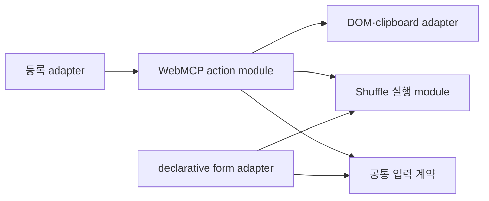

# WebMCP·시리즈·홈 시간표 통합 설계

작성: 2026-10-22
상태: 2026-10-22 사용자 확정 — 세 영역 로컬 구현 완료
기준: 원격 main `ed9da14c90666eb7fafb79fbce16a478091c2fb5`

## 목표와 범위

세 영역에서 호출자가 반복해서 알아야 하는 규칙을 해당 module 내부에 집중한다. 작은 interface 뒤에 행동을 모아 depth를 높이고, 같은 seam을 호출부와 테스트가 사용하게 한다.

| 영역             | 변경 의도                                         | 보존할 동작                                               |
| ---------------- | ------------------------------------------------- | --------------------------------------------------------- |
| WebMCP action    | 선언·검증·노출·실행 결과 통합 및 합의한 동작 수정 | 기존 도구 이름·정상 응답 필드, 지연 로딩, idle/abort 수명 |
| 시리즈 조회·경로 | 반복 정책을 순수 함수 module에 집중               | article/craft 구분, URL, 정렬, 날짜, 빈 시리즈 처리       |
| 홈 등장 시간표   | 묶음 간 이력과 묶음 내 계산을 한 module에 집중    | 타이밍, 접근성, 복귀, 표시 복구, 자연 완료 이벤트         |

기존 작업 폴더는 오래된 HEAD에 다른 작업이 얹혀 있다. 구현은 최신 main을 바탕으로 한 격리된 작업 공간에서 진행했고, 이 문서와 이번 작업의 용어집만 옮겼다. 기존 작업 폴더를 reset·stash하거나 미커밋 변경을 일괄 복사하지 않는다. 후속 요청에 따라 논리 단위 commit·push·PR 생성까지 진행한다. merge와 production 배포는 범위에 포함하지 않는다.

## 1. WebMCP action module

### 확정된 외부 동작

1. 생략한 optional 값에만 기본값을 적용한다. 명시된 잘못된 타입·범위·추가 필드는 실패한다. JSON의 숫자 문자열을 숫자로 자동 변환하지 않는다.
2. imperative 도구와 declarative 폼을 모두 통합 대상에 포함한다.
3. 실제 실행 준비가 된 Shuffle 데모가 있는 Playground와 Craft에서 실행·중단을 제공한다. URL만으로 존재 여부를 판단하지 않는다.
4. 실행 성공은 애니메이션이 실제 시작됐음을 뜻한다. 완료까지 기다리지 않는다. busy 또는 대상 소멸은 실패다. 이미 멈춘 대상에 대한 중단은 성공이다.
5. 대상을 특정하지 않은 호출은 준비된 데모가 정확히 하나일 때만 실행한다. 0개는 대상 없음, 2개 이상은 모호함 오류다. 특정 폼 제출은 그 폼의 데모를 대상으로 한다.
6. 이번에는 targetId, 일괄 제어, 복수 데모의 정식 노출 규약을 추가하지 않는다. 오류는 기존 `ok: false`와 `error` 형식을 사용한다.

### 책임과 interface

- **action module:** 도구 이름·설명·입력 계약·노출 정책·실행 연결을 action별로 함께 소유한다. 등록용 descriptor와 현재 action 목록을 같은 정의에서 만든다.
- **입력 계약:** 현재 사용하는 평면 object와 scalar 필드의 타입·정수 범위·필수 여부·기본값·문자열 정규화를 한곳에 둔다. 여기서 JSON Schema와 runtime 검증을 함께 구성한다. 새 검증 라이브러리나 범용 schema framework는 도입하지 않는다.
- **Shuffle 실행 module:** 한 데모의 입력 반영, 시작, busy, 중단, 원문 복원, 완료, 해제를 소유한다. 폼과 imperative 호출은 동일한 실행 결과를 받는다. 응답을 받지 못하는 window broadcast를 실행 성공의 근거로 사용하지 않는다.
- **등록 adapter:** capability 확인, lazy load, idle 등록, declarative 중복 제거, AbortController 정리를 담당한다.
- **DOM adapter:** heading·code block·series target을 실행 시점에 다시 찾는다. 기존 DOM 추출 module의 locality를 유지한다.

외부 interface의 개념적 형태는 `createWebMCPActions(deps)`에서 현재 action 목록과 등록할 descriptor를 얻는 것이다. descriptor의 execute는 입력 검증과 실제 실행 결과를 거친다. Shuffle의 공통 실행 interface는 데모별 시작·중단·해제로 제한한다. 구체적인 타입 표현은 구현 과정에서 기존 타입과 맞춘다.

### 노출과 수명

- action 목록은 가능한 동작의 목록이다. 실제 imperative 등록 목록과 항상 같지는 않다. 같은 이름의 폼이 있으면 imperative 등록만 생략한다.
- 노출 당시의 조건 확인은 실행 당시의 대상 확인을 대신하지 않는다. 마지막 시리즈 글에 없는 next 요청 등은 실제 실행에서 실패한다.
- 폼 표식만 있는 상태와 실행 준비가 된 데모를 구분한다. 데모의 연결·해제는 해당 action 등록 갱신을 알린다. 같은 경로의 늦은 데모 준비도 처리한다.
- 모든 DOM 변화를 감시하는 범용 registry는 만들지 않는다. 기존 경로 변경의 idle 취소·등록 abort 수명은 유지한다.
- 데모 해제 시 실행 중인 애니메이션도 취소한다. 실제 화면과 연결이 끝난 대상을 실행하지 않는다.
- 폼 adapter는 HTML number control의 값을 읽어 숫자로 전달한다. 이는 외부 JSON의 잘못된 숫자 문자열을 묵인하는 규칙과 구별한다.

### 유지할 차이와 대상 파일

Playground의 기본 반복 횟수/fps는 8/30, MDX의 현재 실행 기본값은 15/40이다. 이 차이와 MDX의 완료 측정 callback, 각 화면의 표현은 유지한다. MDX 검증의 parse 결과 전달 방식은 별도 변경으로 남긴다.

대상은 `src/components/webmcp/{lib,model,ui,types}`, `src/app/playground/shuffle-letters/page.tsx`, `src/mdx/components/shuffle-letters-demo/`다. 공유 실행 module은 독립된 domain과 barrel로 두어 MDX와 Playground가 같은 interface를 사용하게 한다. 일반 폼 사용 때문에 WebMCP 등록 코드가 로드되지 않도록 의존을 분리한다.

### 검증

- 입력 생략/정상/소수/숫자 문자열/추가 필드의 실제 descriptor 실행을 검사한다. 잘못된 입력은 fetch·이동·실행 전에 실패해야 한다.
- 실제 builder·handler·snapshot을 연결한 jsdom 검사에서 등록된 descriptor를 잡아 실행한다. 내부 module 전체를 mock하지 않는다.
- 실제 Shuffle 폼과 등록을 함께 연결해 중복 등록 방지, run→busy→stop, 이미 멈춘 상태의 stop을 검사한다.
- Craft와 Playground, 대상 없음·복수 대상·실행 직전 해제·늦은 준비를 검사한다.
- 경로 변경, pending idle 취소, 부분 등록 실패 rollback, unmount 취소를 보존한다.
- 실제 브라우저의 declarative 제출은 기능 지원 환경에서 별도로 확인한다. 미지원 환경의 jsdom 결과를 브라우저 지원 증거로 주장하지 않는다.

## 2. 시리즈 조회·경로 정책 module

### 책임

`src/lib/series.ts`가 registry, 종류 검사, 시리즈/글 경로 생성, 글 정렬과 이전·다음 조회, 배지·요약을 소유한다. article/craft route adapter는 어떤 컬렉션을 사용할지와 페이지별 표현을 담당한다.

순수 함수와 명시적 전체 컬렉션 전달을 유지한다. 숨겨진 상태를 가진 MDXProcessor를 복원하지 않는다. config·경로는 파일시스템 읽기와 분리해 불필요한 의존이 생기지 않게 한다.

### 구분해야 할 상태

| 상태                             | metadata         | 본문             | 정적 경로·사이트맵        |
| -------------------------------- | ---------------- | ---------------- | ------------------------- |
| 등록되지 않음 / 요청 종류 불일치 | 기존 404         | 기존 404         | 해당 종류 목록에서 제외   |
| 등록됨, 글 없음                  | config 기반 생성 | 기존 404         | 기존처럼 config 기준 포함 |
| 등록됨, 글 있음                  | config 기반 생성 | 정렬된 목록 표시 | 포함                      |

위 표의 본문은 시리즈 목록 페이지다. 개별 article/craft 글의 시리즈 정보가 없거나 잘못된 경우에는 기존처럼 시리즈 내비게이션만 생략한다. 글 자체를 404로 바꾸지 않는다.

등록된 시리즈의 정의와 글이 있는 시리즈 조회를 다음 interface로 구분한다.

| interface                           | 책임                                                                    |
| ----------------------------------- | ----------------------------------------------------------------------- |
| `getSeriesMetadata(query, siteUrl)` | registry만 조회하여 title·description·canonical·OG 생성. 파일 읽기 없음 |
| `resolveSeries(articles, query)`    | 종류 검사, 명시적으로 받은 글의 필터·정렬·경로·이전·다음 계산           |
| `listSeriesRoutes(kind?)`           | 빈 시리즈도 포함한 registry 기준 경로 목록. 정적 경로와 sitemap이 공유  |
| `getSeriesSummaries(articles)`      | 기존 요약에 완성된 route를 포함하여 호출부의 경로 재조합 제거           |
| `getSeriesBadges(articles)`         | 기존 배지 의미와 출력 유지                                              |

`query`는 ID·요청 콘텐츠 종류·선택적인 현재 순서를 전달한다. 현재 순서 생략 시 내부의 명명된 상수로 기존 `-1` 의미를 유지한다. `resolveSeries`는 enum 상태 `Unknown / KindMismatch / Empty / Ready`를 구분한다. metadata 조회는 컬렉션을 읽지 않으므로 `Empty` 상태가 없다. Next adapter에서만 결과를 `notFound()` 또는 내비게이션 생략으로 번역한다.

시리즈 결과 타입도 이 module이 소유한다. 입력은 조회에 필요한 최소 구조 타입을 사용하여 MDX 타입에 대한 역방향 의존을 피한다. 기존 `getSeriesInfo`의 계산은 새 interface에 흡수하며 같은 정책의 공개 진입점을 중복 유지하지 않는다.

### 적용과 검증

- 두 시리즈 route의 metadata·본문, article/craft 상세, 배너, 사이트맵, 구조화 데이터, WebMCP content index를 공통 정책으로 연결한다.
- 기존 URL, Next.js 16의 비동기 params와 React cache, 상대 날짜 표시, 중복 seriesOrder 처리, 항목 순서와 실패 동작을 보존한다. JSON-LD의 position은 기존 article.order를 사용한다. craft WebMCP index에 새 배지를 추가하지 않는다. D2와 충돌하지 않는다.
- `src/lib/series.ts`, `src/mdx/mdx.ts`의 관련 함수와 호출부를 조정한다. 이름만 바꾼 pass-through module은 추가하지 않는다.
- 정상/미등록/타입 불일치/빈 시리즈, 첫·중간·마지막 글, canonical·OG·JSON-LD 경로를 검사한다.
- 현재 순수 함수 검사를 유지하고, 두 route의 metadata와 본문에서 위 상태 구분이 실제로 보존되는지 검증한다.

## 3. 홈 등장 시간표 module

### 책임과 interface

`createHomeSchedule()`은 HomeMotion effect 수명 안에서만 존재하며 이전 묶음의 시작 시각, 그룹별 누적 항목 수, 간격, 지연 상한, blur 예약을 함께 소유한다.

- `plan(items, { now, viewport })`는 DOM 순서의 새 진입 묶음을 받아 `{ id, startAt, blur, distance }[]`를 반환한다. `startAt`은 명시적으로 받은 시각과 같은 기준의 절대 시작 시각이며, 대기 중인 항목도 blur 자리를 예약한다.
- `release(id)`는 완료·취소된 항목의 blur 예약만 반환한다. 중복 호출은 안전하며, 시간·목록 이력은 지우지 않는다.

HomeMotion adapter는 live DOM 관측, DOM 순서, WAAPI 재생/취소, 사용자 입력, 접근성, CSS 표시 복구와 자연 완료 이벤트를 담당한다. DOM 식별을 위한 항목 key는 mount 내에서 안정적으로 유지한다. 시간표 module에 DOM·window·실제 clock을 숨겨 넣지 않는다.

기존 `createHomeRevealPlan` 계산은 시간표 module의 내부 implementation으로 흡수한다. 같은 계산의 공개 interface를 별도로 유지하지 않는다. 전역 모션 엔진이나 교체할 이유가 없는 adapter 계층은 추가하지 않는다.

기존 실행의 취소는 새 `plan`의 예약 전에 처리한다. 새 계획을 받은 뒤 `start`에서 이전 실행을 취소하면서 새 blur 예약까지 반환하는 순서를 만들지 않는다. 항목 ID는 관측 묶음마다 0부터 재시작하지 않고 effect 수명 동안 DOM 요소별로 안정적으로 유지한다.

### 보존 계약

- 900ms 등장, stack/제목 간 36ms, 목록 간 60ms, 섹션 간 120ms, 손글씨 60ms 간격을 보존한다.
- 목록 순차 지연에 적용되는 누적 항목 수 4개 상한, 지연 압축의 600ms 상한과 최대 12개 blur 예약을 보존한다. 기존 묶음과 후속 묶음의 시간 기준을 바꾸지 않는다.
- 최초 뷰포트와 이후 최초 진입은 같은 정책을 사용하며, 이미 시작한 효과는 스크롤로 재생성·취소하지 않는다.
- CSS 600ms 표시 복구, 늦은 hydration, reduced motion, 키보드·포커스, 테마 변경, pagehide, StrictMode cleanup을 보존한다.
- 일반 홈 복귀는 재생하지 않고, opt-in된 지구본 제목의 방문별 재생 예외는 유지한다.
- 자연 완료만 후속 데모 이벤트를 발생시킨다. 즉시 표시·취소를 자연 완료로 취급하지 않는다.
- 기존 HomeViewport enum을 사용한다. 시간·예산의 의미 있는 수치는 공통 상수로 관리한다.

### 적용과 검증

대상은 `src/components/home/lib/home-reveal-plan.ts`, 새 시간표 module, `src/components/home/ui/home-motion.tsx`와 직접 테스트다. 프로필·지구본 연출 자체를 재설계하지 않는다.

새 seam에서는 가짜 시각을 주입해 초기→후속 묶음, 목록 누적 상한, 손글씨 순서, blur 예약·반환·재사용·중복 반환을 검사한다. 기존 순수 계산 검사의 의미 있는 assertion은 실제 `plan/release` interface로 옮기고 private 계산만 직접 검사하는 중복 테스트는 정리한다. HomeMotion에서는 IO 전달 순서, DOM 순서, 실제 계획 적용, 자연 완료/즉시 표시와 cleanup 연결을 검사한다. 브라우저 검증은 실제 스크롤·CSS 복구 등 하위 검사로 입증할 수 없는 동작으로 제한한다.

## 구현 순서와 완료 기준

1. 최신 main의 격리된 작업 공간에서 관련 지침·의존성 버전을 확인한다.
2. WebMCP 불일치와 합의한 동작의 실패 테스트를 먼저 실행한다. 입력 계약→공통 Shuffle 실행→action 조합·등록 연결 순으로 수정한다.
3. 시리즈의 현재 상태별 동작을 먼저 고정하고, 조회·경로 정책을 통합한다.
4. 홈의 시간표·수명 연결을 고정한 뒤 내부 시간표 seam으로 이동한다.
5. 각 단계의 관련 테스트, 변경 TypeScript의 typecheck·대상 lint를 수행한다. 같은 근거가 유효하면 검사를 반복하지 않는다. build·브라우저 검사는 변경 영향과 프로젝트 필수 조건에 맞춰 실행한다.

세 변경은 별도로 검토·되돌릴 수 있는 논리 단위다. 공통 대형 framework로 묶지 않는다. 완료 시 동작 변경과 동작 보존을 구분하고, 실행한 검사와 미검증 브라우저 조건을 기록한다. 구현 및 검증 결과는 아래에 기록한다.

## 구현 결과

작업 공간: `/Users/jaemin/.codex/worktrees/architecture-actions-series-home/bendd`

생성 시 원격 `main`을 조회하여 위 기준 commit과 일치함을 확인했다. 기존 작업 폴더의 앱 코드·Git 상태는 변경하지 않았다.

- `src/components/webmcp/model/actions.ts`가 action 선언·노출·실행 연결을 소유한다. `schemas.ts`의 입력 선언을 `src/lib/action-input.ts`로 검증하며, descriptor를 직접 실행하는 테스트로 잘못된 입력의 side effect 부재를 확인한다.
- `src/components/shuffle/`이 폼과 도구가 공유하는 입력 계약·준비 상태·실행 수명을 소유한다. JSON 숫자 문자열은 거부하고 HTML number control만 `valueAsNumber`로 읽는다. 폼의 범위 선언도 같은 계약을 사용한다.
- `src/lib/series.ts`가 조회 결과·이전/다음·metadata·경로·배지·요약을 소유한다. 잘못된 시리즈 route는 MDX를 읽기 전에 거절하며, 빈 시리즈와 개별 글의 기존 처리를 보존한다.
- `src/components/home/lib/home-schedule.ts`의 `plan/release`가 관측 묶음 사이 이력과 blur 예약을 소유한다. HomeMotion은 안정된 ID로 계획을 적용하고, 기존 실행 취소 후 새 자리를 예약한다.

### 검증 기록

- WebMCP의 초기 회귀 4개를 기존 구현에서 실패시킨 뒤 수정했다. 합의한 입력·실행·수명과 content index를 포함한 관련 테스트 79개가 통과했다.
- 시리즈 route의 기존 처리 12개를 변경 전에 고정했다. 최종 검토에서 잘못된 시리즈의 MDX 읽기 순서를 추가 회귀로 고정했고, 기존 내비게이션 테스트도 실제 `resolveSeries` 결과를 사용하도록 이전했다.
- 홈의 기존 52개 검사를 기준으로 삼았다. 새 시간표 12개와 HomeMotion 42개가 통과했다.
- 전체 unit test: 84개 파일, 779개 테스트 통과. 이후 폼 범위 선언을 공통 계약으로 연결한 변경은 해당 영역의 79개 테스트를 다시 통과했다.
- 전체 lint·format check·typecheck 및 production build 통과. 최종 브라우저 테스트는 `tests/architecture-contracts.spec.ts`에 둔다.
- Chromium production browser 시나리오 4개: Playground·Craft의 기본값/실행/Escape 중단, 홈의 후속 섹션 표시와 복귀, reduced motion 표시.
- 사용한 Chromium에는 `navigator.modelContext`가 없다. 실제 native WebMCP agent 제출은 미검증이다. 등록·descriptor 실행·declarative 응답·늦은 준비는 실제 앱 module을 연결한 jsdom 통합 검사로 검증했으며 native 지원 증거로 해석하지 않는다.

브라우저 검사는 기본적으로 프로젝트의 3000 포트(CI: 3001)를 사용한다. 별도 포트의 production server에서는 `ARCHITECTURE_BASE_URL`을 지정한다.
