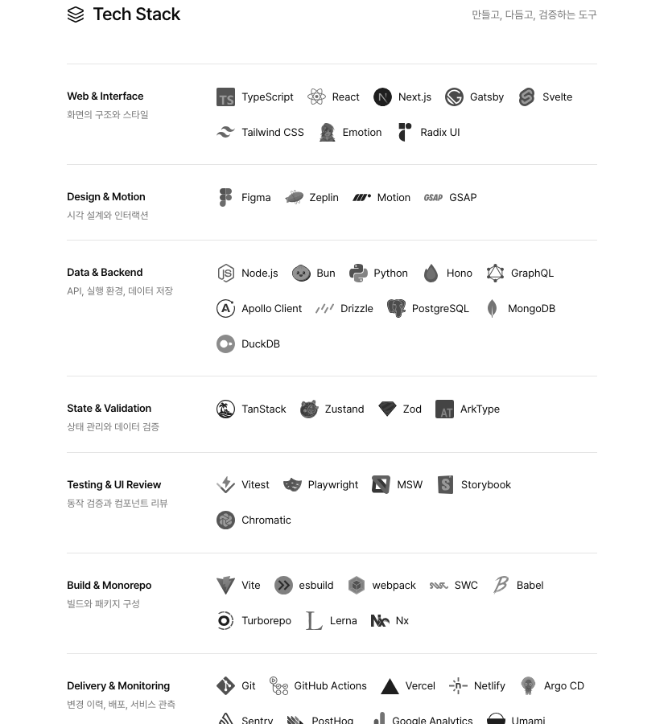

# 웹폰트 최적화 검증

PR 기준은 **origin/main `545b5b5`의 동일한 콘텐츠**다. Next.js 16.4.3 / React 19.3.0으로 원본과 후보를 각각 production build했다. 이전 로컬 Next.js 14 작업트리의 84% 절감 수치는 이 PR의 결과로 사용하지 않는다. 기존 미커밋 작업과 분리한 작업트리에서 HomeStudio 연결까지 실제 소스에 반영했다.

파일 크기는 실제 WOFF2 바이트, 페이지 전송량은 cold cache의 font response body 합이다(HTTP 헤더 제외). wire 수치는 JSON의 encodedBytes/transferBytes로 남겼다. 실제 시계·HTTP 캐시를 보존한 반복 시간 측정은 [로딩 성능 보고서](font-performance.md)에 별도로 기록한다.

## 폰트별 결과

| 역할      |    이전 B |                                       이후 B (파일별) |   차이 B |
| --------- | --------: | ----------------------------------------------------: | -------: |
| content   | 2,057,688 |          1,825,496 (extended 1,804,252 + core 21,244) | -232,192 |
| interface |    56,848 |                                  39,776 (core 39,776) |  -17,072 |
| home      |   108,676 |                                  91,824 (core 91,824) |  -16,852 |
| code-ui   |         0 |              183,164 (extended 161,920 + core 21,244) | +183,164 |
| notes     |    11,068 |                                    6,056 (core 6,056) |   -5,012 |
| serif     |     9,256 |                                    8,832 (core 8,832) |     -424 |
| dots      |     1,636 |                                    1,420 (core 1,420) |     -216 |
| mono-400  |    47,952 | 21,024 (extended 7,392 + symbols 2,904 + core 10,728) |  -26,928 |
| mono-500  |    47,636 |                 18,044 (extended 7,408 + core 10,636) |  -29,592 |
| mono-700  |    47,824 |                 17,964 (extended 7,352 + core 10,612) |  -29,860 |

code-ui는 이전에 큰 content 파일을 공유하던 컴포넌트용 추가 subset이다. content core URL은 code-ui와 공유한다. 역할별 합은 공유 파일을 중복 계산하므로 전체 전송량으로 더하지 않는다. 서버 OG 전용 Inter-SemiBold.ttf 315,756 B는 변경하지 않았다.

## 페이지별 cold font bytes와 preload

| 페이지                                                                  |    이전 B |    이후 B |  절감 B | 고유 preload 전→후 |
| ----------------------------------------------------------------------- | --------: | --------: | ------: | -----------------: |
| `/`                                                                     |   198,240 |   158,636 |  39,604 |              4 → 6 |
| `/article`                                                              | 2,245,172 | 1,844,028 | 401,144 |              4 → 0 |
| `/article/chrome-korean-ime-input-scroll-bug-fix`                       | 2,266,540 | 1,886,612 | 379,928 |              4 → 0 |
| `/article/difference-between-put-patch`                                 | 2,255,928 | 1,876,000 | 379,928 |              4 → 0 |
| `/article/enhancing-type-safety-in-mdx-with-reusable-utility-functions` | 2,255,928 | 1,854,756 | 401,172 |              4 → 0 |
| `/article/fix-compacting-conversation`                                  | 2,269,444 | 1,889,516 | 379,928 |              4 → 0 |
| `/article/http-request-methods`                                         | 2,266,540 | 1,886,612 | 379,928 |              4 → 0 |
| `/article/immediate-motion-component`                                   | 2,266,540 | 1,886,612 | 379,928 |              4 → 0 |
| `/article/improving-mdx-utilities-with-functional-programming`          | 2,255,928 | 1,854,756 | 401,172 |              4 → 0 |
| `/article/managing-cross-cutting-concerns-sound-playback`               | 2,266,540 | 1,865,368 | 401,172 |              4 → 0 |
| `/article/naming-tokens-in-design`                                      | 2,266,540 | 1,886,612 | 379,928 |              4 → 0 |
| `/article/perfect-dark-mode`                                            | 2,266,540 | 1,886,612 | 379,928 |              4 → 0 |
| `/article/precise-scroll-sync-toc-refactoring`                          | 2,266,540 | 1,865,368 | 401,172 |              4 → 0 |
| `/article/save-tokens-for-ai-agent`                                     | 2,269,444 | 1,889,516 | 379,928 |              4 → 0 |
| `/article/script-loading-optimization`                                  | 2,266,540 | 1,886,612 | 379,928 |              4 → 0 |
| `/article/series/ai-coding-agent`                                       | 2,245,172 | 1,844,028 | 401,144 |              4 → 0 |
| `/article/zustand-vs-context-performance`                               | 2,266,540 | 1,886,612 | 379,928 |              4 → 0 |
| `/craft`                                                                | 2,245,172 | 1,865,272 | 379,900 |              4 → 0 |
| `/craft/bringing-arc-tab-switching-to-chrome`                           | 2,266,540 | 1,865,368 | 401,172 |              4 → 0 |
| `/craft/implement-rauno-style-text-animation`                           | 2,266,540 | 1,886,612 | 379,928 |              4 → 0 |
| `/craft/map-a-small-connection`                                         | 2,255,928 | 1,876,000 | 379,928 |              4 → 0 |
| `/craft/series/synchronize-tab-scrolling`                               | 2,245,172 | 1,844,028 | 401,144 |              4 → 0 |
| `/craft/synchronize-tab-scrolling-product-story`                        | 2,266,540 | 1,886,612 | 379,928 |              4 → 0 |
| `/playground/shuffle-letters`                                           | 2,245,172 | 1,844,028 | 401,144 |              4 → 0 |

홈은 **198,240 → 158,636 B (19.98% 감소)**다. 아래쪽 lazy section까지 스크롤해도 이 측정값은 같다. 본문 일반 페이지는 2,266,540 → 1,886,612 B (16.76% 감소), box drawing을 쓰는 두 페이지는 symbols 2,904 B를 추가로 받는다.

이전 홈은 Home/Gaegu/serif/dots 4개를 preload했다. 후보 홈은 UI·mono-400 core와 Home/notes/serif/dots 단일 파일 6개를 preload한다. 비홈에서는 새로 추가한 preload가 FCP를 지연시켜 제거했다. core/extended는 CSS와 unicode-range가 필요한 시점에 요청한다. 따라서 원래의 모든 core preload 요구에서 벗어난 예외이며, 초기 font discovery를 앞당기는 장점은 포기했다. font-display와 fallback은 보존했다. Next.js의 홈 prefetch가 장식 preload를 다른 페이지에 주입하던 문제도 FontPreloads의 pathname 경계로 차단했다. **extended/symbols preload는 없다.** 페이지별 URL은 [verification.json](font-optimization/verification.json), 시간과 비용은 [로딩 성능 보고서](font-performance.md)에 있다.

16개 fresh-context probe에서 ASCII는 core만, 확장 문자는 해당 extended만 추가로, box drawing은 symbols만 추가로 요청했다. 한국어 본문은 content extended, 홈은 Home extended가 필요하다. Shuffle 데모가 생성하는 한글 11,172자를 content에 보존하므로 홈에서 데모를 실행하면 content extended도 필요할 수 있다. idle precache·CSS embedding은 적용하지 않았다.

## 실제 사용 조사와 보존 규칙

- stylesheet뿐 아니라 TSX inline style, portal/숨김 문자열, frontmatter, MDX code, 컴포넌트별 폰트 변수를 조사했다. UI는 TypeScript AST의 문자열/JSX를, Home은 기존 수집 범위를 보존한다. 런타임의 모든 텍스트 노드에 대한 computed font 설정은 raw audit에 저장했다.
- 관측 굵기: 400, 450, 480, 500, 520, 550, 560, 570, 580, 600, 610, 650, 700, 740, 800. serif는 600/650, dots는 700/ROND 0, notes는 400. mono는 원래 400/500/700 세 face와 브라우저 weight matching을 유지한다(450/480→500, 600 및 italic 안의 bold→700).
- `tabular-nums`에 필요한 tnum과 브라우저 기본 shaping의 ccmp/locl/rlig/liga/clig/calt/kern/mark/mkmk/chws를 허용한다. code의 ligature 비활성화, emoji의 명시적 system stack도 그대로다. 프로덕션에는 hyphens:auto 선언이 없지만 fixture에서 auto hyphenation, U+2010, 악센트, 합성 italic 안의 bold를 검사했다.
- content와 code UI에는 사용 문자 + Latin-1/Extended-A를 보존한다. 원래 좁은 UI/Home/장식 폰트의 커버리지를 확장해 fallback 소유권을 바꾸지는 않는다. 원래 웹폰트가 담당하던 한글은 시스템 폰트로 바꾸지 않는다. 한자·일본어·emoji의 기존 platform fallback도 유지한다.
- core에는 ASCII·흔한 곡선 따옴표/대시/말줄임표/U+2010을 둔다. 새 sans core에는 결합 문자를 인코딩하지 않아 브라우저의 악센트 분해 경로가 달라지지 않게 한다. extended에는 shaping helper를 보존한다. 양쪽 face가 fallback보다 먼저 선언된다.
- U+2010이 없던 기존 UI/Home/mono face의 ASCII 하이픈 대체 동작은 명시적인 cmap alias로 보존한다. 각 선언의 unicode-range는 실제 cmap에 포함되는 문자만 광고한다. Fira의 원래 cmap shaping helper 중 Google CSS가 가리던 문자는 계속 가린다.
- 수정한 Pretendard/Gaegu/Noto/Doto 내부 family·PostScript 이름은 Bendd 이름으로 바꾼다. 원래 저작권·OFL은 보존하고 hashed license 파일도 배포한다. Fira는 RFN이 없고 원본 shaping 데이터를 유지한다.
- font-display: sans/UI swap, mono/Home/notes/serif/dots block 및 기존 Arial metric adjustment/system fallback 순서를 유지한다. build/dev는 생성기를 호출하지 않는다.

## 화면 보존 때문에 제외한 최적화와 비용

`--limit-axes`의 절감량은 이번 PR의 글리프 집합으로 측정했다. Home/serif 단일 파일의 값은 같은 전체 cmap을 가진 진단 extended 출력과 비교했다. 축 재기준화가 픽셀을 바꾸므로 기본 생성에는 적용하지 않는다. Pretendard 원본 축은 45/400/930을 보존한다.

| 제외/예외             |        절감 가능 B 또는 비용 | 영향·결정                                                                           |
| --------------------- | ---------------------------: | ----------------------------------------------------------------------------------- |
| content 축 제한       |            566,456 절약 가능 | 축 재기준화 후 1단계 AA 차이; 전체 축 보존                                          |
| interface 축 제한     |             10,448 절약 가능 | 축 재기준화 후 1단계 AA 차이; 전체 축 보존                                          |
| home 축 제한          |             25,780 절약 가능 | 축 재기준화 후 1단계 AA 차이; 전체 축 보존                                          |
| code-ui 축 제한       |             47,100 절약 가능 | 축 재기준화 후 1단계 AA 차이; 전체 축 보존                                          |
| serif 축 제한         |              1,768 절약 가능 | 600–650 제한은 원래 표본 8,060px 차이; 200–900 보존                                 |
| dots 축 제한          |                368 절약 가능 | wght 700 고정은 원래 12px 표본 437px 차이; ROND만 0 고정                            |
| mono 병합·추가 subset |             10,892 절약 가능 | 같은 입력의 Latin/정규화 픽셀이 달라짐. 원래 Latin/Latin-ext 보존, 400 symbols 별도 |
| UI core/extended 분할 |         분할 시 약 19KB 중복 | mixed-script kerning 차이 때문에 UI는 한 파일 유지                                  |
| Home 단일 파일        |      분할 대비 19,832 B 절약 | 재방문 폰트 준비 회귀를 확인해, 항상 함께 쓰던 두 조각을 통합                       |
| notes/serif 단일 파일 | 분할 대비 556 / 1,324 B 절약 | 홈에서 항상 함께 쓰므로 추가 요청·중복 처리 제거                                    |

UI/Home/notes/serif는 단일 파일이다. Home/notes/serif를 미래의 ASCII 전용 화면에 재사용하면 기존 core만 받는 경우보다 각각 71,992 / 5,500 / 7,508 B가 더 필요하다. 현재 홈은 한글 때문에 항상 양쪽을 받았으므로 통합으로 전송량과 요청 수가 줄었다. 원래의 일괄 2분할 요구에서 벗어난 조정이며, 최종 픽셀 차이 0을 확인했다.

mono 400은 3파일, 500/700은 2파일이다. core의 원래 Latin-1/일부 결합 문자 및 unused frac/dnom/numr/gasp를 보존한 예외다. 다른 출력의 hinting과 unused feature는 제거한다. Fira OS/2 v3 bit 7 warning도 원본 렌더링 정책을 유지하기 위해 보존한다. Doto는 원래 ASCII뿐이라 빈 extended를 만들지 않는다. post glyph name 제거도 CJK 픽셀을 바꿔서 보존했다. Latin-1/Extended-A를 좁은 UI/Home/장식 폰트에 새로 추가하면 fallback 소유권이 바뀌므로 원래 범위 안에서만 보존한다. 원래 웹폰트가 그리던 한글을 system font로 바꾸는 최적화도 적용하지 않았다.

## 픽셀 검증

Chromium 151.0.7922.34, macOS 27.0.1, DPR1. 대표 6페이지의 desktop light / mobile light·dark와 악센트·분수 굵기·italic 안 bold·컴포넌트별 폰트·CJK specimen, 한글 11,172자/Latin coverage를 비교했다. **콘텐츠 hash 24개 동일, 22개 PNG의 183,348,000개 픽셀 중 변경 0개**, 허용 오차 0이다.

폰트 로더 교체로 CSS 청크 순서가 바뀌어 Tech Stack 설명의 margin-top 4px가 0px로 덮였고, 데스크톱 홈이 12px 짧아지는 회귀를 발견했다. 해당 selector를 `.group .heading p`로 한정해 기존 desktop 4px / mobile 0px를 보존하고 브라우저 회귀 검사를 추가했다. 최종 비교에서는 그 차이도 0이다. 콘텐츠 변경이나 허용한 sub-pixel 차이는 없다.

canvas만 양쪽에서 동일하게 숨겼다. 영상/GIF는 같은 첫 프레임으로 고정했고 DOM 텍스트는 마스킹하지 않았다. 홈은 lazy section을 스크롤해 노출한 뒤 촬영했다. 사이트 미디어 파일/재생 동작은 변경하지 않았다. Windows/Linux/Safari·다른 DPR의 rasterization은 검증하지 않았다.

홈 Tech Stack 발췌(동일 픽셀):

| 이전                                                | 이후                                               |
| --------------------------------------------------- | -------------------------------------------------- |
|  |  |

검증 원자료는 [verification.json](font-optimization/verification.json), 로컬 전체 캡처는 `output/playwright/font-optimization/{pr-before,pr-after,pr-diff}/`다.

## 원본 파일별 측정

축은 min/default/max, feature는 고유 tag 개수다. 모든 tag·hinting·cmap 수·SHA는 [before-fonts.json](font-optimization/before-fonts.json), 출력별 정보는 [generated-manifest.json](../src/app/fonts/generated-manifest.json)에 있다.

| 파일                                               |         B | glyphs / cmap | 축                             | OT features     | hinting                       |
| -------------------------------------------------- | --------: | ------------: | ------------------------------ | --------------- | ----------------------------- |
| `src/app/fonts/PretendardVariable.woff2`           | 2,057,688 | 14757 / 14336 | wght 45/400/930                | GSUB 47, GPOS 4 | 없음; TT 0                    |
| `src/app/fonts/PretendardInterface.woff2`          |    56,848 |     533 / 200 | wght 45/400/930                | GSUB 36, GPOS 2 | 없음; TT 0                    |
| `src/app/fonts/PretendardHome.woff2`               |   108,676 |     848 / 514 | wght 45/400/930                | GSUB 36, GPOS 2 | 없음; TT 0                    |
| `public/fonts/gaegu-notes.woff2`                   |    11,068 |       38 / 37 | static                         | 없음            | fpgm, prep, cvt , gasp; TT 36 |
| `public/fonts/profile/profile-serif.woff2`         |     9,256 |       31 / 22 | wght 200/200/900               | GSUB 8, GPOS 7  | prep, gasp; TT 0              |
| `public/fonts/profile/profile-dots.woff2`          |     1,636 |       16 / 15 | ROND 0/0/100; wght 100/900/900 | 없음            | prep, gasp; TT 0              |
| `src/app/api/og/Inter-SemiBold.ttf`                |   315,756 |   2547 / 2505 | static                         | GSUB 32, GPOS 3 | prep, gasp; TT 0              |
| `scripts/font-sources/fira/400-cyrillic-ext.woff2` |     9,900 |     237 / 191 | static                         | GSUB 0, GPOS 0  | gasp; TT 0                    |
| `scripts/font-sources/fira/400-cyrillic.woff2`     |     5,660 |     139 / 105 | static                         | GSUB 0, GPOS 1  | gasp; TT 0                    |
| `scripts/font-sources/fira/400-greek-ext.woff2`    |     4,776 |     274 / 236 | static                         | GSUB 1, GPOS 0  | gasp; TT 0                    |
| `scripts/font-sources/fira/400-greek.woff2`        |     6,564 |     158 / 124 | static                         | GSUB 1, GPOS 0  | gasp; TT 0                    |
| `scripts/font-sources/fira/400-latin-ext.woff2`    |     7,392 |     239 / 162 | static                         | GSUB 1, GPOS 2  | gasp; TT 0                    |
| `scripts/font-sources/fira/400-latin.woff2`        |    10,756 |     272 / 225 | static                         | GSUB 4, GPOS 2  | gasp; TT 0                    |
| `scripts/font-sources/fira/400-symbols.woff2`      |     2,904 |     156 / 153 | static                         | GSUB 1, GPOS 0  | gasp; TT 0                    |
| `scripts/font-sources/fira/500-cyrillic-ext.woff2` |     9,800 |     237 / 191 | static                         | GSUB 0, GPOS 0  | gasp; TT 0                    |
| `scripts/font-sources/fira/500-cyrillic.woff2`     |     5,648 |     139 / 105 | static                         | GSUB 0, GPOS 1  | gasp; TT 0                    |
| `scripts/font-sources/fira/500-greek-ext.woff2`    |     4,648 |     274 / 236 | static                         | GSUB 1, GPOS 0  | gasp; TT 0                    |
| `scripts/font-sources/fira/500-greek.woff2`        |     6,596 |     158 / 124 | static                         | GSUB 1, GPOS 0  | gasp; TT 0                    |
| `scripts/font-sources/fira/500-latin-ext.woff2`    |     7,408 |     239 / 162 | static                         | GSUB 1, GPOS 2  | gasp; TT 0                    |
| `scripts/font-sources/fira/500-latin.woff2`        |    10,664 |     272 / 225 | static                         | GSUB 4, GPOS 2  | gasp; TT 0                    |
| `scripts/font-sources/fira/500-symbols.woff2`      |     2,872 |     156 / 153 | static                         | GSUB 1, GPOS 0  | gasp; TT 0                    |
| `scripts/font-sources/fira/700-cyrillic-ext.woff2` |     9,924 |     237 / 191 | static                         | GSUB 0, GPOS 0  | gasp; TT 0                    |
| `scripts/font-sources/fira/700-cyrillic.woff2`     |     5,732 |     139 / 105 | static                         | GSUB 0, GPOS 1  | gasp; TT 0                    |
| `scripts/font-sources/fira/700-greek-ext.woff2`    |     4,720 |     274 / 236 | static                         | GSUB 1, GPOS 0  | gasp; TT 0                    |
| `scripts/font-sources/fira/700-greek.woff2`        |     6,612 |     158 / 124 | static                         | GSUB 1, GPOS 0  | gasp; TT 0                    |
| `scripts/font-sources/fira/700-latin-ext.woff2`    |     7,352 |     239 / 162 | static                         | GSUB 1, GPOS 2  | gasp; TT 0                    |
| `scripts/font-sources/fira/700-latin.woff2`        |    10,612 |     272 / 225 | static                         | GSUB 4, GPOS 2  | gasp; TT 0                    |
| `scripts/font-sources/fira/700-symbols.woff2`      |     2,872 |     156 / 153 | static                         | GSUB 1, GPOS 0  | gasp; TT 0                    |

## 재실행

콘텐츠·컴포넌트 문구·inline/CSS weight/axis/feature·원본 폰트가 바뀌면 수동 재생성하고 출력물을 함께 커밋한다. `FEATURES`, 축 사용 범위, `CORE`, UI/Home 수집 범위도 검토한다. Home의 원래 cmap은 random shuffle의 fallback 경계이므로 현재 보이는 문자만으로 좁히지 않는다.

```sh
python3 -m venv .font-tools-venv
source .font-tools-venv/bin/activate
python -m pip install -r scripts/font-requirements.txt
pnpm install --frozen-lockfile
pnpm fonts:optimize
```

생성은 offline이며 dev/build에 연결하지 않았다. 반복 생성한 WOFF2·CSS·TS가 일치함을 확인했다. manifest의 sourceHash는 폰트에 영향을 주지 않는 CSS 편집도 기록한다. `--limit-axes`, `--experimental-merge-mono`는 픽셀 회귀를 재현하는 진단 옵션이다. `--output-root /tmp/...`로 출력 경로를 분리할 수 있다.

동일 콘텐츠의 원본 checkout과 후보를 별도로 production build/start한다. 이번 기준 빌드는 `/tmp/bendd-font-pr-baseline`이다. Playwright >=1.45의 Clock API가 필요하며 기존 설치가 오래되면 `FONT_AUDIT_PLAYWRIGHT`에 최신 설치 모듈 경로를 지정한다. Python 환경에는 Pillow가 필요하다.

```sh
node scripts/audit-fonts.mjs http://localhost:3140 output/playwright/font-optimization/pr-before /tmp/bendd-font-pr-baseline
node scripts/audit-fonts.mjs http://localhost:3141 output/playwright/font-optimization/pr-after .
python scripts/compare-font-pixels.py output/playwright/font-optimization/pr-before output/playwright/font-optimization/pr-after output/playwright/font-optimization/pr-diff
node scripts/check-font-delivery.mjs http://localhost:3141 output/playwright/font-optimization/pr-delivery
```

production build, typecheck, lint, format, unit 807개, 홈/MDX/Shuffle 브라우저 15개, delivery 16개 및 저장소 CI의 availability/incident/sentry 검사를 통과했다. hashed 파일의 `Cache-Control: public, max-age=31536000, immutable`도 확인했다. HomeStudio 폰트 연결은 별도 patch가 아니라 이 PR의 실제 소스 변경으로 포함한다. 원래 작업트리의 기존 미커밋 경로 477개는 수정하지 않았다.
