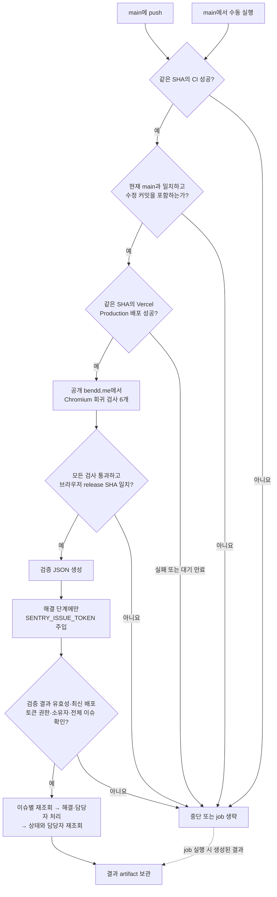
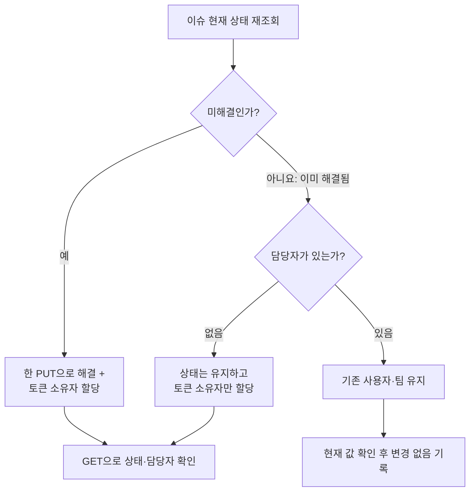

# 배포 검증 후 Sentry 이슈 자동 해결

`main`의 CI와 실제 프로덕션 회귀 검증이 통과하면, 명시한 Sentry 이슈를
해결하고 **Sentry 토큰 소유자**를 담당자로 지정한다. 현재 대상은 Dock·Giscus의
`localStorage` 차단 오류 BENDD-3·BENDD-4와 통합 검증용 BENDD-5다.

이 문서는 PR #174의 병합 커밋 `8385ec5`를 기준으로 작성했다.
인증 설정과 운영 세부 사항은 [관측 운영 문서](observability.md#배포-검증-후-sentry-이슈-자동-해결)를 참고한다.

## 전체 흐름



자동 실행은 이 저장소의 `main` **push CI 성공**으로 시작한다. 수동 실행도
`main`만 허용하며, PR·포크·Preview 이벤트에서는 해결 단계를 실행하지 않는다.
배포 준비 중에는 30초 간격으로 최대 약 10분 기다린다.

앞단 검사가 실패하면 Sentry를 변경하지 않는다. 이슈별 처리 중 API 오류가
발생하면 이전 이슈의 변경은 남을 수 있다. 실패해도 생성된 결과는 가능한 범위에서
보관하며, 재실행은 이미 완료된 처리 상태를 확인하고 이어 간다.

## 무엇을 검증하나

| 단계        | 통과 조건                                                                                                |
| ----------- | -------------------------------------------------------------------------------------------------------- |
| 커밋·배포   | 체크아웃·현재 `main`·성공한 push CI·최신 Vercel Production 배포의 SHA 일치. 목록의 모든 `fixCommit` 포함 |
| 실제 서비스 | 공개 `https://bendd.me`에서 첫 로드와 새로고침 후 `window.SENTRY_RELEASE.id`가 해당 SHA와 일치           |
| 회귀 검사   | 아래 6개 시나리오가 중복·누락 없이 모두 통과                                                             |
| 검증 결과   | 같은 job에서 생성한 결과의 SHA·계획 hash·배포 ID/URL 일치, 검증 후 30분 이내. 배포와 CI도 재조회         |
| Sentry      | 쓰기 scope·사용자 ID 확인 후 전체 대상의 프로젝트·ID·Short-ID·상태·관측 상한 확인                        |
| 변경 결과   | 각 변경 직전 재조회, 변경 후 `resolved`와 예상 담당자 일치 확인                                          |

보호된 Vercel 배포 URL은 배포 식별에 사용하고, 브라우저 검사는 공개 도메인에서
수행한다. 공개 도메인이 아직 이전 배포를 가리키면 SHA 검사에서 중단한다.

| 회귀 시나리오                       | 확인할 동작                                    |
| ----------------------------------- | ---------------------------------------------- |
| 글: `localStorage` 속성 getter 차단 | Dock 크기 조절·새로고침, Giscus 대체 안내      |
| 글: `getItem` 차단                  | 같은 동작을 읽기 거부 상황에서 확인            |
| 글: `setItem` 차단                  | 같은 동작을 쓰기 거부 상황에서 확인            |
| 글: `removeItem` 차단               | 같은 동작을 삭제 거부 상황에서 확인            |
| 홈: getter 차단                     | 실제 사이트 탐색 Dock 크기 조절·새로고침       |
| 정상 글: 저장소 허용                | Dock 설정 유지, Giscus iframe·로그인 링크 표시 |

각 시나리오는 새 브라우저 컨텍스트를 사용한다. 차단 시나리오에서는 실제
차단 코드가 호출됐는지도 확인한다. 차단된 글 화면은 Giscus 외부 스크립트·iframe을 로드하지 않으며,
차단 시나리오의 JS·console 오류가 없어야 한다. 정상 글은 uncaught JS 오류가
없어야 한다. Giscus의 댓글 토론 미생성 `Discussion not found` 응답은 정상 검사에서
별도로 취급한다. 로그인·댓글·분석 동의는 제출하지 않는다.

## 담당자는 어떻게 정하나



담당자는 Git 커밋 작성자나 PR 작성자가 아니라 `SENTRY_ISSUE_TOKEN`의 사용자다.
토큰 소유자가 바뀌면 이후 자동 해결 담당자도 바뀐다. **미해결 이슈는 기존 담당자가
있어도 토큰 소유자로 지정**하며, 이미 해결·할당된 이슈는 기존 할당을 유지한다.

사용자 ID를 확인할 수 없거나 권한이 부족하면 중단한다. 결과에는 숫자형 사용자
ID만 남기며, 이메일·전체 사용자 프로필·토큰 값은 기록하지 않는다.

## 설정과 대상 관리

- GitHub Actions secret `SENTRY_ISSUE_TOKEN`: 조직 `jaemin`의 `bendd` 이슈에
  접근 가능한 사용자 토큰. `event:read`·`event:write`를 부여한다.
  쓰기 검사는 `event:admin`도 허용한다.
- `GITHUB_TOKEN`: `contents`·`actions`·`deployments` 읽기 권한으로 CI와 배포를 확인한다.
- 소스맵 업로드용 Vercel `SENTRY_AUTH_TOKEN`과 이슈 처리용 토큰은 별개다.
- 토큰 scope와 소유자 조회는 Sentry의 PRIVATE API에 의존한다.
  응답 형식 변경·조회 실패는 해결 중단으로 처리한다.

대상은 [issues.json](../scripts/sentry-resolution/issues.json)에 명시한다.
목록 밖의 이슈는 조회하거나 변경하지 않는다.

| 필드                      | 의미                                                                        |
| ------------------------- | --------------------------------------------------------------------------- |
| `id` / `shortId`          | 변경할 숫자형 이슈 ID와 `BENDD-*` 식별자                                    |
| `fixCommit`               | 배포에 반드시 포함되어야 하는 실제 수정 커밋                                |
| `observedThrough`         | 이 수정이 해결한다고 검증한 관측 시각의 상한. `lastSeen`이 더 최신이면 중단 |
| `purpose` / `testEventId` | 합성 검증 대상 식별용 선택 메타데이터. 어떤 검사도 생략하지 않음            |

새로운 원인의 이슈는 **원인 수정과 해당 회귀 검사**를 먼저 추가한다. 다른 버그의
검사로 닫히도록 ID만 추가하거나, 재발한 이슈를 닫기 위해 관측 상한만 늘리지 않는다.

## 실행과 결과 확인

로컬 게이트 회귀 검사는 다음 명령으로 실행한다. Sentry 상태는 변경하지 않는다.

```bash
pnpm test:sentry
```

`main`에 반영된 워크플로를 수동 실행하려면 다음 명령을 사용한다.
**모든 게이트를 통과하면 실제 Sentry 상태와 담당자가 변경된다.**

```bash
gh workflow run sentry-resolution.yml --repo jaem1n207/bendd --ref main
```

Actions 실행의 `sentry-resolution-<SHA>` artifact에서 다음 파일을 확인한다.
보관 기간은 **14일**이며, 로컬 실행 결과 경로는 Git에서 제외된 `.sentry-resolution/`다.

| 파일              | 확인할 내용                                                               |
| ----------------- | ------------------------------------------------------------------------- |
| `checks.json`     | 브라우저 검사별 통과 여부                                                 |
| `verified.json`   | 검증 SHA·배포 정보·계획 hash·검증 시각·전체 검사                          |
| `resolution.json` | 최종 `phase: resolved`, 이슈별 변경 전 상태·담당자, `action`, 최종 담당자 |

`action`은 `resolve`(해결·할당), `assign`(할당만), `none`(변경 없음)이다.
실패한 실행에서는 결과가 일부만 있거나 파일이 없을 수 있으므로 Actions 로그도
확인한다. Sentry API는 일괄 트랜잭션을 제공하지 않는다. 부분 실패 후에는 원인을
확인하고 재실행하며, 배포가 바뀌었거나 검증 결과가 만료됐으면 검증부터 다시 수행한다.

자동 처리를 멈추려면 Actions에서 워크플로를 비활성화하거나 전용 secret을 제거한다.
잘못 해결한 이슈는 Sentry에서 **Unresolve**, 잘못 할당한 담당자는 **Assignee**를
수정해 복구한다. 자동 처리가 다시 덮어쓰지 않도록 먼저 대상 목록도 점검한다.

## 실제 통합 검증 기록

2026-10-16 23:28 KST, PR #174의 병합 커밋 `8385ec5`에 대해 프로덕션 검증 6개가
통과했고, 아래 세 분기가 실제 API 처리 결과로 확인됐다. 이는 해당 실행 시점의
기록이며 이후 배포의 통과 여부는 각 Actions 실행에서 다시 확인한다.

| 이슈    | 처리 전            | 실제 동작 | 처리 후                 |
| ------- | ------------------ | --------- | ----------------------- |
| BENDD-3 | 해결됨·담당자 있음 | `none`    | 기존 상태·담당자 유지   |
| BENDD-4 | 해결됨·미할당      | `assign`  | 해결됨·토큰 소유자 할당 |
| BENDD-5 | 미해결·미할당      | `resolve` | 해결됨·토큰 소유자 할당 |

BENDD-5는 `automation-test` 환경에 고유 fingerprint로 합성 오류를 **한 번** 전송한
통합 검증용 이슈다. 수동으로 해결하지 않고 자동 워크플로가 실제 해결·할당했으며,
처리 후 Sentry UI에서도 확인했다. 정기적인 합성 오류 생성은 포함하지 않는다.

- [구현 PR #174](https://github.com/jaem1n207/bendd/pull/174)
- [자동 해결 실행과 artifact](https://github.com/jaem1n207/bendd/actions/runs/38915967005)
- [같은 커밋의 main CI](https://github.com/jaem1n207/bendd/actions/runs/38915563760)
- [테스트 이슈 BENDD-5](https://jaemin.sentry.io/issues/7796215406/)

14일 후 artifact가 만료되면 JSON 상세 증거는 이 링크에서 내려받을 수 없을 수 있다.
위 표는 검증 당시의 요약 기록이다.

## 구현 위치

- [워크플로 트리거·권한·단계](../.github/workflows/sentry-resolution.yml)
- [실행 진입점](../scripts/sentry-resolution/run.mjs)
- [배포·검증·해결 게이트](../scripts/sentry-resolution/gates.mjs)
- [GitHub·Sentry API와 담당자 처리](../scripts/sentry-resolution/api.mjs)
- [실제 브라우저 회귀 검사](../scripts/sentry-resolution/regression.mjs)
